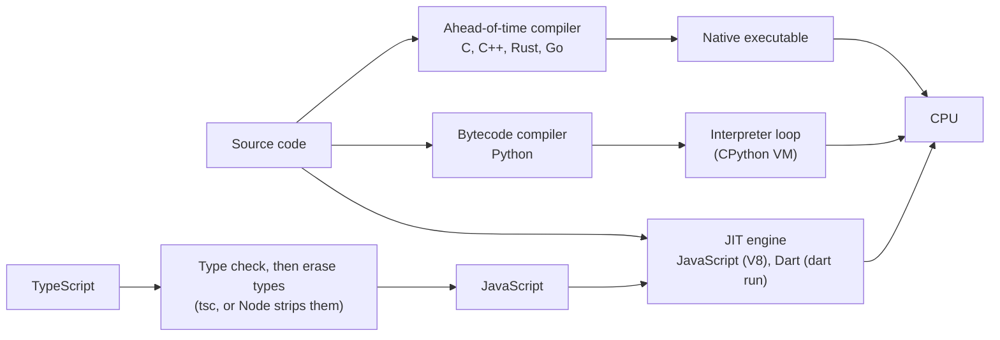

# Chapter 1: Toolchains and Hello World

In this chapter you install all eight toolchains, run the same program in every
language, and learn how each one turns source code into a running process. By the
end you can read input, print output, report errors, and run the exercise checker.

**Languages:** all 8 · **Time:** 2 to 3 hours, most of it installing things

| You will learn | Why it matters later |
| --- | --- |
| The three ways code gets executed | Explains every performance and startup difference in the book |
| How to build and run one file, and how to start a real project | Every chapter's exercises |
| stdin, stdout, stderr, and exit codes | Every exercise is checked through them |
| How to run `tools/check.py` | You check your own answers with it from now on |

---

## 1.1 The concept: from source code to a running program

Every language has to turn text into something a CPU can run. The eight languages
in this book do it in three different ways.



1. **Ahead-of-time (AOT) compiled: C, C++, Rust, Go.** A compiler translates the whole
   program into machine code before it runs. You ship a single executable. Startup is
   instant and the compiler catches many mistakes before the program ever runs. Go
   also bundles a small runtime with a garbage collector into every binary.
2. **Bytecode interpreted: Python.** CPython compiles each file to bytecode (the
   `.pyc` files in `__pycache__/`) and runs it in an interpreter loop. There is no
   separate build step, so most errors only appear when that line runs.
3. **Just-in-time (JIT) compiled: JavaScript, Dart.** The engine starts by
   interpreting, watches which code runs often, and compiles that code to machine
   code while the program runs. Dart can also compile ahead of time
   (`dart compile exe`), which is what you ship.

TypeScript is a special case. It is JavaScript plus a type system that exists only
at compile time. The type checker (`tsc`) reads your types, reports errors, and then
the types are erased. What runs is plain JavaScript, so a TypeScript type can never
fail at runtime.

You can feel the difference. Here is Hello World's total run time on one Linux test
machine (median of 10 runs, including process startup):

| Language | Time to run Hello World | What is happening |
| --- | --- | --- |
| C | 1.1 ms | Load a 16 KB executable and run it |
| Rust | 1.4 ms | Same, plus Rust's slightly larger standard library |
| Go | 1.4 ms | Same, plus starting the Go runtime |
| C++ | 1.9 ms | Same, plus loading the C++ standard library |
| Dart, compiled with `dart compile exe` | 3.6 ms | Native executable with the Dart runtime inside |
| Python | 14 ms | Start the interpreter, compile to bytecode, run |
| JavaScript | 28 ms | Start V8 and Node, parse, run |
| TypeScript (`node main.ts`) | 69 ms | Same as JavaScript, plus stripping the types |
| Dart, run with `dart run` | 269 ms | Start the VM and JIT-compile the program |

None of this matters for a program that runs for an hour. It matters a lot for a
command-line tool you run 500 times in a script.

---

## 1.2 Installing the toolchains

Install everything once. On Windows, use [WSL](https://learn.microsoft.com/windows/wsl/install)
so every command in this book works exactly as written.

| Language | Install | Version used in this book | Check it worked |
| --- | --- | --- | --- |
| C and C++ | Linux: `sudo apt install build-essential` · macOS: `xcode-select --install` | GCC 13+ or Clang 16+ (C17, C++20) | `cc --version` and `c++ --version` |
| Rust | [rustup.rs](https://rustup.rs) | 1.95+ (2024 edition) | `rustc --version` |
| Go | [go.dev/dl](https://go.dev/dl/) | 1.23+ | `go version` |
| Python | [python.org](https://www.python.org/downloads/) or `uv python install 3.13` | 3.12+ | `python3 --version` |
| JavaScript | [nodejs.org](https://nodejs.org) LTS, or a version manager such as fnm | Node 22.18+ | `node --version` |
| TypeScript | `npm install` in the repo root (installs the compiler locally) | TypeScript 7 | `npx tsc --version` |
| Dart | [dart.dev/get-dart](https://dart.dev/get-dart) (Flutter includes it) | 3.x | `dart --version` |

Then, from the repo root:

```sh
npm install                       # TypeScript compiler and Node type definitions
python3 tools/check.py --doctor   # lists every toolchain it can find
```

Every line should say `ok`. A missing toolchain is not fatal: the checker marks that
language `SKIP` and keeps going.

---

## 1.3 Hello, World in eight languages

The code is in [`examples/01-hello/`](examples/01-hello/).

**C**

```c
#include <stdio.h>

int main(void) {
    printf("Hello, World!\n");
    return 0;
}
```

`#include` pastes the declarations from the `stdio.h` header into your file before
compiling. `main` returns an `int` that becomes the process's exit code, and 0 means
success. `printf` does not add a newline, so you write `\n` yourself.

**C++**

```cpp
#include <iostream>

int main() {
    std::cout << "Hello, World!\n";
    return 0;
}
```

`std::cout` is an output stream, and `<<` pushes values into it. `std::` is a
namespace, C++'s way of avoiding name clashes. C++23 adds
`std::println("Hello, World!");`, which works like Python's `print`. This book uses
C++20 because C++23 support is still uneven across compilers.

**Rust**

```rust
fn main() {
    println!("Hello, World!");
}
```

The `!` means `println!` is a macro, not a function. Macros run at compile time, so
Rust can check the format string against its arguments before the program exists.
Get `{}` placeholders wrong and it will not compile.

**Go**

```go
package main

import "fmt"

func main() {
	fmt.Println("Hello, World!")
}
```

Every Go file belongs to a package. The package named `main` with a function named
`main` is what becomes an executable. Go code is indented with tabs, and `gofmt`
formats it for you. Nobody argues about Go formatting.

**Python**

```python
print("Hello, World!")
```

There is no `main`. Python runs the file top to bottom, which is why it is so quick
to write scripts in.

**JavaScript**

```js
console.log("Hello, World!");
```

JavaScript was designed to run inside web pages, so the language itself has no input
or output at all. `console` is provided by the host: the browser, or Node.js here.

**TypeScript**

```ts
const greeting: string = "Hello, World!";
console.log(greeting);
```

This is the JavaScript version plus one type annotation, `: string`. Delete the
annotation and you have valid JavaScript. That is the whole relationship between the
two languages.

**Dart**

```dart
void main() {
  print('Hello, World!');
}
```

Dart looks like a cross between Java and JavaScript. It has a `main` like C, a
`print` like Python, and single-quoted strings by convention.

---

## 1.4 Building and running

Each language has a quick way to run one file and a proper way to start a project.
Single files are fine for chapters 1 to 16. Chapter 17 covers projects and builds in
depth.

| Language | Run one file | Start a real project | Build for release |
| --- | --- | --- | --- |
| C | `cc -std=c17 -Wall -Wextra main.c -o main && ./main` | CMake (chapter 17) | add `-O2` |
| C++ | `c++ -std=c++20 -Wall -Wextra main.cpp -o main && ./main` | CMake (chapter 17) | add `-O2` |
| Rust | `rustc main.rs && ./main` | `cargo new hello && cd hello && cargo run` | `cargo build --release` |
| Go | `go run main.go` | `go mod init example.com/hello` | `go build` |
| Python | `python3 main.py` | `uv init hello` | not compiled; see chapter 17 for packaging |
| JavaScript | `node main.js` | `npm init -y` | runs as is |
| TypeScript | `node main.ts` (types stripped, **not** checked) and `npx tsc --noEmit main.ts` to check them | `npm init -y && npm install -D typescript` | `tsc` writes `.js` files |
| Dart | `dart run main.dart` | `dart create hello` | `dart compile exe main.dart` |

Always compile C and C++ with `-Wall -Wextra`. Without them the compiler stays quiet
about mistakes it has already noticed, such as an unused variable or a missing
`return`. The checker goes further and adds `-Werror`, which turns every warning into
an error.

The REPLs are worth knowing. A REPL is an interactive prompt where you type an
expression and see its value at once. `python3` and `node` open one with no
arguments. `dart` and `go` have none built in, and `evcxr` is a community REPL for
Rust.

---

## 1.5 Reading input, writing output, and exit codes

Every process starts with three open streams:

- **stdin** (standard input): what the user types, or what is piped in with `<` or `|`.
- **stdout** (standard output): normal results.
- **stderr** (standard error): error messages. It is kept separate so that
  `./main > out.txt` still shows errors on the screen.

When a process ends it returns an **exit code**: 0 for success, anything else for
failure. Shell scripts, CI systems, and `tools/check.py` all read it.

### Reading one line

The program below reads a line and prints it back. The code is in
[`examples/02-echo/`](examples/02-echo/).

```sh
$ echo "hi there" | ./main
You typed: hi there
```

**C**

```c
#include <stdio.h>
#include <string.h>

int main(void) {
    char line[256];
    if (fgets(line, sizeof line, stdin) == NULL) {
        line[0] = '\0';                  // no input at all
    }
    line[strcspn(line, "\r\n")] = '\0';  // cut the line ending off
    printf("You typed: %s\n", line);
    return 0;
}
```

In C you supply the memory: a 256-byte array on the stack. `fgets` will not write
past it, but a longer line is cut in two. A string is just bytes ending in `'\0'`,
so "removing the newline" means writing a `'\0'` over it.

**C++**

```cpp
#include <iostream>
#include <string>

int main() {
    std::string line;
    std::getline(std::cin, line);        // removes the '\n', not a '\r'
    if (!line.empty() && line.back() == '\r') {
        line.pop_back();
    }
    std::cout << "You typed: " << line << '\n';
}
```

`std::string` grows as needed, so there is no fixed buffer. A `main` in C++ that ends
without a `return` returns 0 automatically.

**Rust**

```rust
use std::io;

fn main() {
    let mut line = String::new();
    io::stdin().read_line(&mut line).expect("failed to read stdin");
    let line = line.trim_end_matches(['\r', '\n']);  // read_line keeps the newline
    println!("You typed: {line}");
}
```

Three Rust ideas appear at once. `let mut` makes a variable that can change, and
variables cannot change by default. `&mut line` lends `read_line` permission to
modify the string (chapter 10). `.expect(...)` says "if reading failed, crash with
this message", the simplest form of Rust error handling (chapter 11).

**Go**

```go
package main

import (
	"bufio"
	"fmt"
	"os"
	"strings"
)

func main() {
	reader := bufio.NewReader(os.Stdin)
	line, _ := reader.ReadString('\n') // the error only says "end of input" here
	line = strings.TrimRight(line, "\r\n")
	fmt.Println("You typed: " + line)
}
```

Go functions often return two values: a result and an error. `_` throws the error
away, which is acceptable here because the only possible error is "input ended".
`:=` declares a variable and infers its type.

**Python**

```python
import sys

line = sys.stdin.readline().rstrip("\r\n")
print(f"You typed: {line}")
```

`input()` also reads a line, but it raises `EOFError` when there is no input at all.
`sys.stdin.readline()` returns `""` instead, which is easier to handle. An `f"..."`
string fills in `{line}` for you.

**JavaScript**

```js
import { readFileSync } from "node:fs";

const input = readFileSync(0, "utf8"); // 0 is stdin's file descriptor
const line = input.split(/\r?\n/)[0];
console.log(`You typed: ${line}`);
```

Node's usual way to read stdin is asynchronous: it fires events as data arrives
(chapter 16). For a small command-line program it is simpler to read everything at
once. File descriptor `0` is stdin on every operating system.

**TypeScript**

```ts
import { readFileSync } from "node:fs";

const input: string = readFileSync(0, "utf8"); // 0 is stdin's file descriptor
const line: string = input.split(/\r?\n/)[0] ?? "";
console.log(`You typed: ${line}`);
```

The `?? ""` means "use an empty string if the left side is `undefined`". TypeScript
does not need it here, but it is a good habit, because indexing an array can return
`undefined` at runtime. With the stricter `noUncheckedIndexedAccess` option,
TypeScript makes you write it.

**Dart**

```dart
import 'dart:io';

void main() {
  final line = stdin.readLineSync() ?? ''; // null means end of input
  print('You typed: $line');
}
```

`readLineSync()` returns `String?`, which is a `String` or `null`. Dart's null safety
will not let you use it as a `String` until you deal with the `null` case. `??` does
exactly that.

### Errors and exit codes

| Language | Print to stderr | Exit with code 1 |
| --- | --- | --- |
| C | `fprintf(stderr, "bad input\n");` | `return 1;` from `main`, or `exit(1);` |
| C++ | `std::cerr << "bad input\n";` | `return 1;` from `main`, or `std::exit(1);` |
| Rust | `eprintln!("bad input");` | `std::process::exit(1);` |
| Go | `fmt.Fprintln(os.Stderr, "bad input")` | `os.Exit(1)` |
| Python | `print("bad input", file=sys.stderr)` | `sys.exit(1)` |
| JavaScript | `console.error("bad input");` | `process.exit(1);` or set `process.exitCode = 1` |
| TypeScript | same as JavaScript | same as JavaScript |
| Dart | `stderr.writeln('bad input');` | `exit(1);` from `dart:io` |

A Rust program that panics (for example, through `.expect`) exits with code 101. A
Python program that crashes exits with code 1. Both print the reason to stderr.

---

## 1.6 Side-by-side summary

| | Execution | Entry point | Print a line | Read a line | Statements end with | Blocks |
| --- | --- | --- | --- | --- | --- | --- |
| C | AOT native | `int main(void)` | `printf("...\n")` | `fgets` | `;` | `{ }` |
| C++ | AOT native | `int main()` | `std::cout << ... << '\n'` | `std::getline` | `;` | `{ }` |
| Rust | AOT native | `fn main()` | `println!` | `stdin().read_line` | `;` (blocks are expressions) | `{ }` |
| Go | AOT native, with GC runtime | `func main()` in `package main` | `fmt.Println` | `bufio.Reader.ReadString` | newline (compiler inserts `;`) | `{ }` |
| Python | Bytecode VM | top of the file | `print` | `sys.stdin.readline` | newline | indentation |
| JavaScript | JIT (V8) | top of the file | `console.log` | `readFileSync(0)` | `;`, optional | `{ }` |
| TypeScript | Checked, erased, then JS | top of the file | `console.log` | `readFileSync(0)` | `;`, optional | `{ }` |
| Dart | JIT in development, AOT for release | `void main()` | `print` | `stdin.readLineSync` | `;` | `{ }` |

---

## 1.7 Why each language looks the way it does

- **C** was built in the early 1970s to write Unix, on machines with kilobytes of
  memory. Everything is explicit: you include headers, size your own buffers, and
  return an exit code because Unix shells needed one.
- **C++** kept C's model and added abstractions you only pay for when you use them.
  Streams (`<<`) were the type-safe replacement for `printf`. After 30 years of
  complaints about their verbosity, C++23 brought back a `printf`-like `std::print`.
- **Rust** wants C's speed without C's memory bugs. That leads to explicit mutability
  (`mut`), explicit borrowing (`&mut`), and macros that check format strings at
  compile time. More of your mistakes become compile errors.
- **Go** was designed at Google for large teams and fast builds. An unused import or
  variable is a compile error, there is one formatting style, and errors are ordinary
  return values, so you can always see where they are handled.
- **Python** puts readability first. Indentation is the syntax, there is no build
  step, and the file is the program. You give up startup speed and compile-time
  checks.
- **JavaScript** was written in 10 days in 1995 to script web pages. That is why it
  has no built-in I/O, and why `;` is optional (automatic semicolon insertion).
  Node.js later gave it a file system and a terminal.
- **TypeScript** adds types to JavaScript without changing how JavaScript runs. The
  types cost nothing at runtime, but they also protect nothing at runtime.
- **Dart** was created by Google as a structured language for apps and is now mostly
  used with Flutter. JIT gives fast edit-and-reload during development, and AOT gives
  fast startup for shipped apps. Null safety is built into the type system.

---

## 1.8 Pitfalls

| Language | Mistake | What happens |
| --- | --- | --- |
| C | Using `gets()` | It cannot know your buffer's size, so long input overwrites memory. It was removed in C11; use `fgets` |
| C | A line longer than the buffer passed to `fgets` | The line is silently split across two reads |
| C++ | `std::endl` in a loop | It flushes the stream on every line, which makes large outputs much slower; use `'\n'` |
| C++ | `std::cin >> n` followed by `std::getline` | `getline` reads the leftover newline and returns an empty line |
| Rust | Reusing a `String` with `read_line` in a loop | `read_line` appends, so call `line.clear()` before each read |
| Go | An unused variable or import | Compile error, not a warning |
| Python | `input()` with no input left | Raises `EOFError` |
| Python | Mixing tabs and spaces | `TabError`; configure your editor to insert 4 spaces |
| JavaScript | `return` on a line by itself, value on the next line | Automatic semicolon insertion returns `undefined` |
| TypeScript | Trusting `node main.ts` to check types | Node only strips types; run `npx tsc --noEmit` to check them |
| TypeScript | Using `enum` or `namespace` with Node's type stripping | Node refuses to run them, because they are not just types that can be erased |
| Dart | Treating `readLineSync()` as a `String` | Compile error until you handle `null` |
| All | Input from Windows ends lines with `\r\n` | A stray `\r` ends up in your strings unless you trim it |

---

## 1.9 Idiom check

Code that works is not always code that looks native. Two examples from this chapter:

**Python: guard your entry point.** Top-level code runs whenever the file is
imported, including by tests. Idiomatic scripts put the work in a function:

```python
def main() -> None:
    print("Hello, World!")


if __name__ == "__main__":
    main()
```

`__name__` is `"__main__"` only when the file is run directly, not when it is imported.

**Rust: return errors instead of crashing.** `.expect()` is fine in examples. Real
programs let `main` return a `Result` and use `?` to pass errors upward (chapter 11):

```rust
use std::io;

fn main() -> Result<(), io::Error> {
    let mut line = String::new();
    io::stdin().read_line(&mut line)?;
    println!("You typed: {}", line.trim_end());
    Ok(())
}
```

---

## 1.10 Exercises

Each exercise has a `README.md` with the rules, a starter file per language in
`exercises/`, test cases in `exercises/<name>/tests/`, and reference answers in
`solutions/`. Try each one yourself before you look.

| # | Exercise | Practises |
| --- | --- | --- |
| 0 | Install all eight toolchains until `python3 tools/check.py --doctor` shows 8 × `ok` | Section 1.2 |
| 1 | [Greet](exercises/01-greet/) | Reading a line, trimming, an `if` |
| 2 | [FizzBuzz](exercises/02-fizzbuzz/) | Parsing a number, a loop, `%` |
| 3 | [Sum lines](exercises/03-sum-lines/) | Reading until input ends, 64-bit integers |

Check your work:

```sh
python3 tools/check.py 01                 # every language
python3 tools/check.py 01 --lang rust     # one language
python3 tools/check.py 01 --solutions     # the reference answers, which should all pass
```

A failing test shows the first line that differs:

```text
01-toolchains-and-hello-world (exercises)
  01-greet
    FAIL  Rust        01-name: line 1: expected 'Hello, Ada!', got '<no line>'
```

To run one test by hand, pipe its input file into your program:

```sh
cd chapters/01-toolchains-and-hello-world/exercises/01-greet
python3 python/main.py < tests/01-name.in
```

**Stretch:** reproduce the startup timing table in section 1.1 on your own machine.
Use `hyperfine` if you have it, or run `time` ten times in a loop. Then build the Rust
version with `cargo build --release` and compare the binary sizes of C (about 16 KB),
Go (about 2 MB), and Rust (about 4 MB, or about 350 KB after `strip`). Can you
explain the difference?

---

Next: [Chapter 2: Values, types, and variables](../02-values-types-and-variables/)
